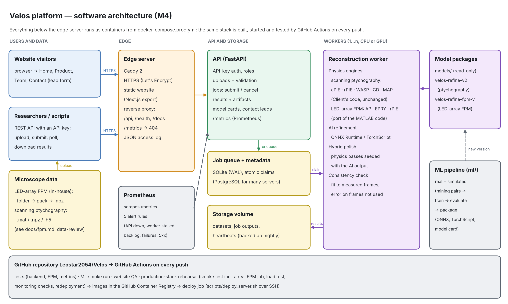

# Velos BioImaging platform — architecture (M1 deliverable, updated at M2, M3 and M4)

```
                         ┌──────────────────────────────┐
   browser ──────────────▶  Website (Next.js, static)    │   Home · Product · Team · Contact
                         │  website/                     │   contact form → POST /api/v1/contact
                         └──────────────┬───────────────┘
                                        │ NEXT_PUBLIC_API_URL
   researcher / script ─── X-API-Key ───▼──────────────────────────────────────────────┐
                         ┌──────────────────────────────┐        ┌─────────────────────┐│
                         │  API (FastAPI)  backend/      │        │  SQLite (WAL)        ││
                         │  velos_backend.main           │◀──────▶│  datasets · jobs ·   ││
                         │  /datasets /jobs /result      │        │  contact leads       ││
                         └──────────────┬───────────────┘        └──────────┬──────────┘│
                                        │ writes uploads                     │ claims    │
                         ┌──────────────▼───────────────┐        ┌──────────▼──────────┐│
                         │  Storage (Docker volume;      │◀──────▶│  Worker process(es)  ││
                         │  object storage: later)       │ results│  velos_backend.worker││
                         │  datasets/<id>/  jobs/<id>/   │        └──────────┬──────────┘│
                         └──────────────────────────────┘                   │           │
                                                                 ┌───────────▼──────────┐│
                                                                 │ velos_recon           ││
                                                                 │ Client's physics      ││
                                                                 │ engines (core.py),    ││
                                                                 │ LED-array FPM (fpm.py)││
                                                                 │ + refine.py: ONNX     ││
                                                                 │ model package, hybrid ││
                                                                 └──────────────────────┘│
   Production (M4): Caddy edge (TLS, static site, /api proxy) → api → worker(s); Prometheus scrapes /metrics
   (compose profile "monitoring"); the whole stack is rehearsed by CI on every push — see docs/deployment.md
```



## Components

| Component | Location | Stack | Status at M2 |
|---|---|---|---|
| Website | `website/` | Next.js 15 (App Router) + Tailwind, static export, content in `content/site.json` | Home, Product, Team, Contact working; SEO metadata, sitemap, robots, analytics hook; contact form wired to API |
| API | `backend/velos_backend/main.py` | FastAPI, SQLModel/SQLite, API-key auth | Upload / job / status / result / artifact / cancel / contact endpoints, Swagger docs |
| Queue + worker | `backend/velos_backend/queue.py`, `worker.py` | DB-backed queue with atomic claim; worker is a separate process | Jobs never block the web request; progress + cancellation |
| Physics engines | `backend/velos_recon/` | Client's `ptycho_core.py` vendored unchanged (`core.py`) + driver, data loaders, metrics, viz | ePIE / rPIE / WASP / GD / MAP selectable per job |
| ML pipeline | `ml/velos_ml/` | PyTorch, YAML configs | Synthetic (v2) and experimental training data, refinement U-Net v2, two-stage training, evaluation vs GT / dense reference with registration, ONNX + TorchScript packaging with model card (M3) |
| ML runtime | `backend/velos_recon/refine.py`, `normalise.py` | ONNX Runtime (CPU/CUDA), TorchScript fallback | Model packages in `VELOS_MODEL_DIR`; 256-px tiles with Hann blending; hybrid physics polish; data-consistency check (M3) |
| LED-array FPM (M4) | `backend/velos_recon/fpm.py`, `velos_backend/fpm_jobs.py` | NumPy/SciPy | Port of the in-house MATLAB AP/EPRY/rPIE engine (validated against MATLAB), acquisition-folder / packed / API loaders, reduced-LED sets, data and prediction errors, FPM model packages |
| Monitoring (M4) | `GET /metrics`, `deploy/prometheus/` | Prometheus, JSON logs, health checks | jobs, queue age, durations, HTTP counters, worker heartbeats; 5 alert rules |
| Deployment | `docker-compose.prod.yml`, `docker-compose.gpu.yml`, `deploy/`, `*/Dockerfile*`, `scripts/deploy_server.sh`, `.github/workflows/ci.yml` | Docker, Caddy, GitHub Actions, GHCR | M4: production stack built, started, smoke/load/monitoring/redeploy-tested by CI on every push; images published; server deploy script; GPU worker override |

## Key design decisions

1. **Physics logic is integrated, not rewritten.** `velos_recon/core.py` is the Client's `ptycho_core.py` with a one-line
   shim exposing the per-iteration step; a unit test proves the service reproduces the Client's engine bit-for-bit.
   Service-level behaviour (geometry, probe seeding, progress, cancellation) lives in `engine.py`.
2. **Queue without a broker for M2.** SQLite in WAL mode + an atomic conditional `UPDATE` claim gives correct
   multi-worker semantics on a laptop or a single VM. The claim/finish interface maps directly onto Celery/RQ if a
   distributed broker is needed at M4.
3. **Storage behind a 4-method interface** (`storage.py`) so an object-store backend can be added without touching
   the API or worker.
4. **Secrets only in the environment** (`VELOS_API_KEYS`, …); `.env.example` files document every variable.
5. **Static website.** No server-side rendering is needed for a marketing site; the export can be hosted on any CDN,
   nginx (see `website/Dockerfile`) or S3+CloudFront. Editable content lives in one JSON file.
6. **ML as a post-processing stage.** The first model refines the physics reconstruction from a sparse scan
   rather than replacing the physics; this keeps the quantitative reference intact and matches the SPARK mode
   model (physics-based → sparse-scanning → AI-assisted → hybrid).
7. **Model packages, not checkpoints, in production (M3).** The worker loads a self-describing directory
   (`model.onnx`, `model.ts`, `model_card.json` with normalisation, tile size, training data, evaluation,
   limitations and file hashes) through ONNX Runtime; no training code or PyTorch is needed in the API image.
   Several packages can be installed side by side and selected per job.
8. **Every ML output is checked against the measurements (M3).** The worker reports the data-consistency error
   (Fourier-magnitude misfit to the measured diffraction patterns) of the physics, ML and hybrid estimates and
   flags results that fit the data much worse than the physics; the physics result is always kept.
9. **One platform, two microscopes (M4).** LED-array FPM datasets carry `modality = fpm`; the same upload, job,
   status, result, model-package and consistency-check machinery serves both modalities; model cards declare their
   modality and a job only ever uses a package of its own modality.
10. **Operations are part of the code (M4).** Metrics, alert rules, health checks, log format, deploy script and the
    CI rehearsal of the production stack live in the repository, so a redeployment is reproducible by anyone with
    the repository and a server.

## Request flow (end to end)

1. `POST /api/v1/datasets` (multipart) → file stored, parsed with `velos_recon.load_dataset` (format + geometry
   validation), summary saved → `201 {id, summary}`.
2. `POST /api/v1/jobs {dataset_id, engine, iters, …}` → row inserted with `status=queued` → `202` immediately.
3. Worker claims the job, runs `velos_recon.reconstruct` with a throttled progress callback (DB updates every
   0.5 s), checks for cancellation, writes `result.npz`, PNGs, `summary.json`, optionally runs ML refinement.
4. `GET /api/v1/jobs/{id}` shows `running · iteration k/N`; `GET …/result` lists artifacts and metrics;
   `GET …/artifacts/<name>` streams a file.

## Interfaces agreed at kickoff

* Dataset formats: MATLAB `expt` struct (`.mat`), `.npz`, `.h5` with `dps`, `positions`, `wavelength`,
  `pixel_pitch`, `distance`, optional `init_probe`, `ground_truth`.
* Job parameters: `engine`, `iters`, `seed`, `crop`, `sparse_every`, `engine_params`, `refine_ml`; M3 adds
  `sparse_fraction`, `model`, `hybrid_iters`, `probe_from_job` (see `docs/api.md`).
* Result bundle: `result.npz` (object, probe, mask, positions, dx, error history), `amplitude.png`, `phase.png`,
  `preview.png`, `probe.png`, `convergence.png`, `summary.json` (+ `refined.npz`, `refined_*.png`, `hybrid.npz`,
  `hybrid_*.png`, `comparison.png` when ML / hybrid mode is applied).
