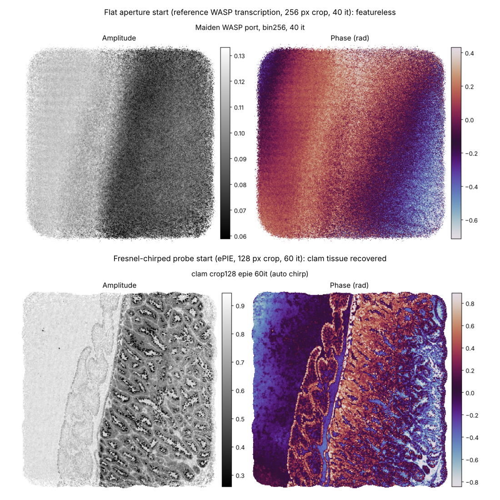

# Data review and physics-engine validation (M1 deliverable, completed in the M2 sprint)

## 1. Datasets received from the Client

| Dataset | Type | Frames | Frame size | λ | Detector pitch | Distance | Sample pixel | Notes |
|---|---|---|---|---|---|---|---|---|
| `real data - clam.mat` | experimental, optical | 400 (20×20 jittered serpentine raster) | 512×512 | 635 nm | 29.6 µm | 60 mm | 2.51 µm | 0.5 mm pinhole probe (`initProbe` mask), scan span ≈ 2.9 mm |
| `real data - plant.mat` | experimental, optical | 200 | 512×512 | 675 nm | 29.6 µm | 29.5 mm | 1.31 µm | far-field experiment of the WASP paper |
| `simulated cell data - noisy.mat` | simulation | 400 | 512×512 | 2.4 nm | 27 µm | 0.5 m | 86.8 nm | no ground truth stored in the file |
| `ptycho_core.py` simulation framework | simulation | configurable | 64×64 probe, 256×256 object | — | — | — | — | ground truth available → used for ML training/evaluation |
| FPM datasets (U2OS, HeLa, USAF; Tian et al.) | experimental, Fourier ptychography | 293 LEDs | 2560×2160 | 514 nm | 6.5 µm | — | — | different modality (LED array); not used in M2, candidate for a later SPARK mode |

All files are in the Maiden `expt` struct layout (`dps` M×N×J with DC centred, `positions.x/.y` in metres,
`wavelength`, `cameraPixelPitch`, `cameraLength`). `velos_recon.load_dataset` reads this layout and the
`.npz`/`.h5` equivalents and validates shapes, finiteness and positivity.

## 2. Findings that changed the implementation

### 2.1 The clam data is in the Fresnel regime — seed the probe curvature
The probe aperture (a = 0.25 mm) at z = 60 mm has Fresnel number N_F = a²/(λz) ≈ 1.6, so the detector is **not**
in the far field of the aperture. The far-field FFT model used by all engines remains exact if the probe carries
the quadratic phase exp(iπr²/λz) (Fresnel propagation = FFT of the chirped exit wave, up to a detector-plane
phase that intensities do not see). Starting from a flat aperture, every engine (including a transcription of the
reference WASP algorithm) produced a featureless object after 40–150 iterations; seeding the chirp gave the clam
tissue structure within 40 iterations. `ReconConfig.probe_chirp="auto"` applies the chirp when N_F > 0.3.

### 2.2 Cropping vs binning diffraction frames
For CPU previews the 512×512 frames must be reduced. **Centre-cropping** keeps the real-space frame extent
(λL/p = 1.29 mm ≥ 2× probe diameter) so intensity sampling stays valid, at coarser resolution (5.0 µm at 256 px,
10 µm at 128 px). **Binning** halves the frame extent (0.64 mm < 1.0 mm needed for a 0.5 mm probe) and
alias-corrupts the intensities; it must not be used on this data. The initial probe is resampled, not cropped,
when frames are cropped (an earlier bug produced a probe twice its physical size).

### 2.3 Engine behaviour
* On the Client's simulation framework (phantoms with 0.6–3 rad phase, 121-frame dense scans), the batch
  `WASP`-style engine with `probe_lr = 0.1` gave the lowest error (NRMSE ≈ 0.02–0.04 after ramp removal);
  `probe_lr = 1.0` (the paper default) oscillated. `rPIE` and `ePIE` also converged (NRMSE ≈ 0.1).
* On the experimental clam data the sequential `ePIE` engine (α = β = 1) converged in 40–60 iterations whereas the
  batch `WASP`-style engine stalled in 60–150 iterations. The service default is therefore `epie`; all engines
  remain selectable per job and the choice is recorded in every result.
* Residual errors of good reconstructions were dominated by a **linear phase ramp** (raster-scan ambiguity).
  `velos_recon.metrics` removes the ramp and the global complex scalar before computing NRMSE / PSNR / SSIM;
  the ML normalisation uses the same ramp estimator so training inputs are consistent without ground truth.

### 2.4 "Overlap" definitions
`ptycho_core.make_positions(overlap=…)` defines overlap relative to the 64-px frame, but the soft aperture is
≈ 39 px wide, so frame-overlap 0.70 ≈ 51 % true aperture overlap and 0.60 ≈ 33 %. The ML dataset uses
frame-overlap 0.70 (121 frames, dense) vs 0.60 (64 frames, −47 %), which matches the "30–50 % fewer scans"
product target and is degraded-but-recoverable; 0.50 (49 frames, ≈ 20 % true overlap) is not recoverable.

## 3. Licensing note for the Client
`WASP.m`, `GRP_WASP.m` (derived from it) and the example datasets are distributed under Maiden et al.'s academic,
**non-commercial** licence, and the header points to Phase Focus Ltd's ptychography patent portfolio. The
platform therefore integrates only the Client's own Python engines and uses the example datasets for internal
development/testing. Before any public demo or commercial release, Velos should (a) acquire its own datasets,
(b) review the Phase Focus licence position for commercial ptychography software. This is a business decision
outside the contractor's scope and is flagged here for completeness.
