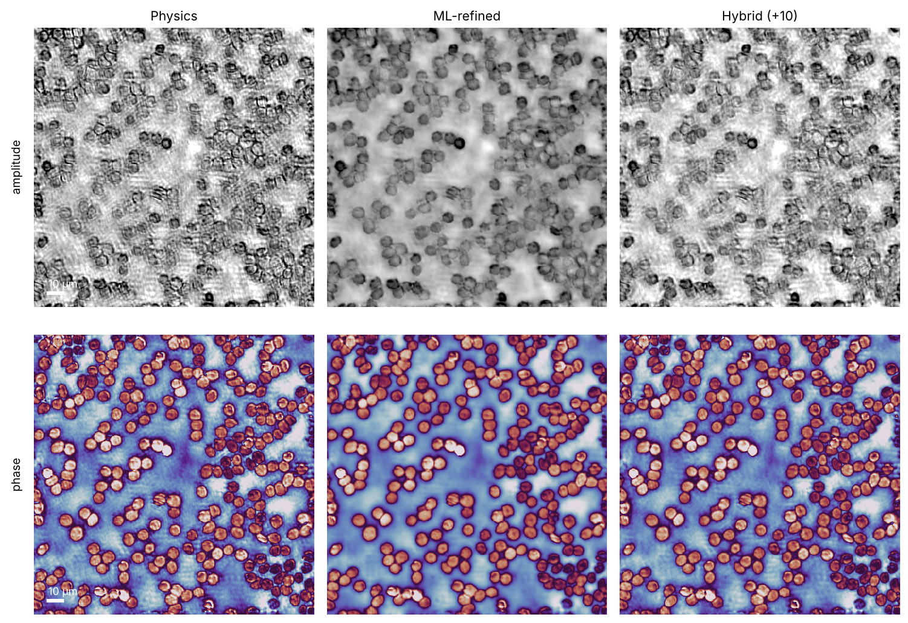

# LED-array Fourier ptychography (FPM) in the Velos platform (M4)

The in-house microscope is an LED-array Fourier ptychographic microscope: an Olympus upright body with
a 4×/0.10 objective, a Thorlabs CS2100M-USB monochrome camera (1920 × 1080, 5.04 µm pixels, 16-bit),
and a 15 × 15 block of a 3 mm-pitch LED panel about 55–60 mm below the sample, driven by an ESP32 board
that is synchronised with the camera (one software trigger per LED). The acquisition software writes one
folder per scan:

```
fpm_cs2100m_raster_YYYYMMDD_HHMMSS/
    positions.csv        index, pixel_x, pixel_y, led_x_mm, led_y_mm, kx/ky, file, exposure, ...
    run_info.json        camera, exposure, LED pitch and distance, scan pattern, status
    led_001_x35_y59.tif  ... one 16-bit frame per LED (225 for the 15 × 15 raster)
```

## Engine: `velos_recon.fpm`

`velos_recon/fpm.py` is a line-by-line Python port of the Client's MATLAB quick-check engine
`main_led_fpm_AP_EPRY_rPIE_CS2100M.m` (version 2, 19 Nov 2026). It keeps the MATLAB conventions so
results can be compared directly:

| Step | What it does (as in MATLAB) |
|---|---|
| patch | `Np × Np` camera pixels around the image centre (or `crop_center_x/y_px`); LED angles are computed for the patch centre (point source 5–6 cm below the sample) |
| geometry | LED position → illumination NA → integer spectrum shifts; reconstruction grid `N_obj` chosen automatically (`upsample`) |
| frame order | low → high illumination NA |
| pre-processing | saturated pixels ignored, background from the darkest frame (or a given offset), hot sensor pixels replaced (5 × 5 median), exposure/gain normalisation, frames with a clipped dark level left out |
| transition LEDs | LEDs whose direct beam is cut by the aperture edge are detected from the clear background (or ±10 % of the NA) and left out |
| geometry check | short AP runs on the low-angle frames compare LED distance, panel orientation and optical-axis offset (`report` or `apply`) |
| engines | AP (pupil fixed), EPRY (pupil recovered), rPIE (regularised, α = β = 0.5), 2 object-only warm-up passes, one brightness factor per frame (1/3 … 3, re-normalised every pass) |
| output | `<ALGO>_amplitude.tif`, `<ALGO>_phase.tif` (curvature and tilt removed), `<ALGO>_pupil_phase.tif`, `frames.csv`, `summary.txt`, `comparison.png`, plus `result.npz` (complex objects, pupils, residuals, unwrapped phase) |

Additions for the platform: loaders for packed crops (`*_meta.npz` / `*_meta.mat` from
`tools/fpm_packing/pack_fpm_for_velos.py` / `.m`) and for the single-file API format, a least-squares (DCT) phase
unwrapper, the data residual of any object against the frames (`fpm_data_error`), the prediction
error on LEDs that were not used, the reduced-LED-set selection, and the hybrid polish (EPRY seeded with a
refined object).

```bash
python -m velos_recon.fpm run <acquisition folder | *_meta.mat | dataset.npz> --Np 512 --z 55 --lambda 0.633 \
       --warmup 0 --passes 50 --geometry-check report --out results/leaf
python -m velos_recon.fpm convert <folder> examples/my_scan_c256.npz --crop 256 \
       --set lambda_um=0.633 z_source_mm=59.4 optical_axis_x_mm=-0.70 optical_axis_y_mm=-0.23 Np=256
```

## Validation against the MATLAB results (leaf section, 23 Nov 2026, 512-px centre patch)

Same frames, same settings as the MATLAB run (λ = 0.633 µm, z = 55 mm, NA 0.10, 4×, 0 warm-up + 50 passes):

| Quantity | MATLAB (`summary.txt`) | Python port |
|---|---|---|
| frames used / transition LEDs left out | 221 / (28,54) (30,52) (26,52) (28,50) | 221 / the same four LEDs |
| check list | offset not removed; 0 BF-dark, 3 DF-bright LEDs; 4 transition LEDs | identical messages |
| geometry-check misfit (as set) | 0.4377 | 0.4377 |
| grid / synthetic NA | 1536 px, 0.420 µm, 0.5751 | 1536 px, 0.420 µm, 0.575 |
| AP final data residual | 0.2955 | **0.2955** |
| EPRY final data residual | 0.2340 | 0.2324 |
| rPIE final data residual | 0.2345 | 0.2401 |
| EPRY amplitude image vs MATLAB | — | Pearson r = 0.986, SSIM 0.946 |
| EPRY phase image vs MATLAB | — | median difference 0.07 rad |

AP (no pupil update) is reproduced to four digits. EPRY and rPIE differ by 0.7 % and 2.4 % in the final
residual: the MATLAB leaf run used a later script version (with LEAP) on a GPU in single precision, and
pupil-update rounding accumulates over 11 000 updates. The images agree closely.

The geometry check also reproduces the MATLAB finding for the blood smear: starting from z = 55 mm it
selects z = 59.4 mm and an optical-axis offset of (−0.70, −0.23) mm (MATLAB: 58.6 mm, (−0.72, −0.24) mm).

## Notes on the data (check list)

* LED colour: the CS2100M scans of 23 Nov were taken with **red LEDs (λ = 0.633 µm)**, as confirmed by
  Velos on 25 Nov 2026; this is the wavelength of the MATLAB analysis and of the platform. Their
  `run_info.json` says GREEN: the `led_color` field is not reliable and should be fixed in the acquisition
  program (the ToupTek scans of 16 Nov were taken with green light, 0.532–0.542 µm in the MATLAB runs,
  although labelled RED). Always enter the wavelength of the light actually used: a wrong wavelength is
  absorbed by a wrong fitted LED distance.
* No dark frame is recorded: the camera offset (~60 grey levels) is not removed. Recording one dark
  frame per exposure time (`dark_<exposure>us.tif`) would improve the dark-field frames.
* About 3 300 isolated hot pixels per 512-px patch are repaired automatically.
* The four blood scans of 23 Nov show the same field of view (repeated acquisitions; one with 2 s
  exposure), and so do the three leaf scans — useful for repeatability, but the AI model must be tested on
  other regions of the sample (see `docs/ml-pipeline.md`, M4).

## API

Upload a Velos FPM `.npz` (`python -m velos_recon.fpm convert …`) to `POST /api/v1/datasets`; the
summary reports `modality: "fpm"`. Jobs use the FPM engines:

```json
{"dataset_id": "…", "engine": "fpm",          // fpm (= EPRY) | fpm-ap | fpm-epry | fpm-rpie | fpm-all
 "iters": 24,                                  // passes after the warm-up
 "fpm": {"Np": 256, "geometry_check": "report"},
 "sparse_fraction": 0.5,                       // optional: reduced LED set (all LEDs inside 1.1 × NA + 50 % of the rest)
 "refine_ml": true, "hybrid_iters": 5}         // optional: FPM model package + hybrid polish (5 recommended)
```

The result summary contains the residuals, the patch geometry, the check list, the data residual and —
for a reduced LED set — the prediction error on the LEDs that were not used, and, with `refine_ml`, the
same numbers for the refined and the hybrid estimates (`consistency` flag as for ptychography).

## AI refinement on real samples (M4)

`models/velos-refine-fpm-v1` (modality `fpm`) refines the EPRY reconstruction of a **reduced LED set** (all LEDs
inside 1.1 × NA + 30–50 % of the dark-field LEDs, i.e. about a third to a half of the acquisition time) toward the
reconstruction from all LEDs. It was fine-tuned from the M3 model on the blood-smear and leaf scans of 23 Nov
(left 65 % of the field only) and evaluated on the right 35 %, on unseen LED draws and on sensor regions never used
for training — results, figures and limitations in `docs/ml-pipeline.md` (M4) and `evidence/ml_m4/`.

**End-to-end through the API** (`scripts/demo_m4.sh`, transcripts in `evidence/api_m4/`) on 160 × 160-px crops of
the hold-out region: upload → reference job with all LEDs → job with ~73 LEDs + FPM model + 10 hybrid passes.

| Hold-out crop | LEDs used / all | Data error on the LEDs used (physics / AI / hybrid) | Prediction error on the LEDs **not** used (physics / AI / hybrid) | Job time (2 CPU cores) |
|---|---|---|---|---|
| blood smear 222619 | 72 / 218 | 0.155 / 0.154 / 0.151 | 0.405 / **0.361** (−11 %) / 0.384 (−5 %) | 19 s all LEDs · 11 s reduced + AI + hybrid |
| leaf section 214040 | 74 / 222 | 0.223 / 0.231 / 0.202 | 0.513 / 0.565 (+10 %) / **0.504** (−2 %) | 18 s · 11 s |



The consistency numbers come with every job, so the user sees when the AI estimate fits the measurements worse than
physics (leaf: prefer the hybrid or the physics result).
