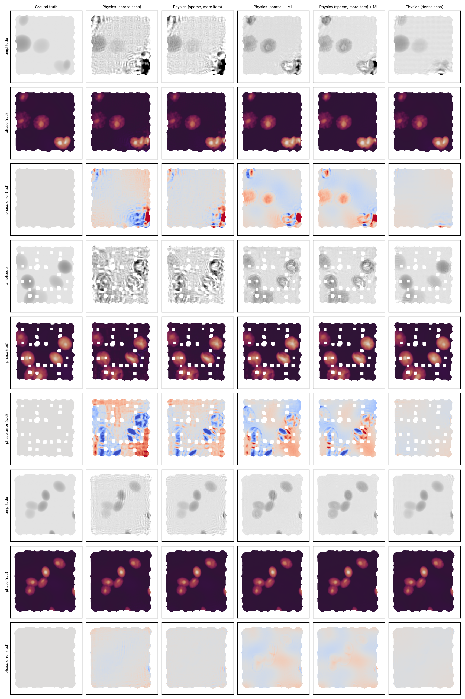

# ML pipeline — first baseline results (M2)

## Setup
* **Task**: sparse-scan refinement. Input = Client's physics engine (`wasp`, probe_lr 0.1, 100 it) on a sparse scan
  (64 frames, frame-overlap 0.60 ≈ 33 % true aperture overlap); target = ground-truth complex object.
  Dense reference = same engine on 121 frames (frame-overlap 0.70), 120 it.
* **Data**: 200 / 25 / 30 synthetic cell phantoms (phase 0.6–3 rad, nuclei, weak absorption, texture; probe
  variants; photons 5e3–5e4 per frame, Poisson). Generated with the Client's forward model (`core.simulate`).
* **Model**: residual U-Net, 3 → 2 channels (Re, Im, mask → Re, Im), base 32, depth 3, 1.93 M parameters.
* **Training**: AdamW 1e-3 + OneCycle, masked L1, 128 px random crops with flips/rotations, batch 8, 30 epochs,
  seed 0, CPU (2 cores, ≈ 20 min). Best val loss 0.0370 (epoch 29).
* **Metrics**: inside the region illuminated by both scans, after removing the global complex scalar and the
  linear phase ramp (both unobservable in ptychography). n = 30 test phantoms, mean ± std.

## Results (test split)

| Method | NRMSE ↓ | PSNR amp (dB) ↑ | SSIM amp ↑ | PSNR phase (dB) ↑ | SSIM phase ↑ | MAE phase (rad) ↓ |
|---|---|---|---|---|---|---|
| Physics baseline (sparse, 100 it) | 0.120 ± 0.072 | 8.2 ± 4.9 | 0.140 ± 0.072 | 32.7 ± 7.0 | 0.765 ± 0.162 | 0.060 ± 0.043 |
| Physics baseline (sparse, 300 it) — control | 0.090 ± 0.062 | 10.5 ± 5.9 | 0.213 ± 0.110 | 36.9 ± 8.7 | 0.885 ± 0.113 | 0.036 ± 0.029 |
| Physics (sparse, 100 it) + ML | 0.095 ± 0.055 | **14.6 ± 5.2** | **0.504 ± 0.113** | 33.9 ± 6.7 | 0.784 ± 0.123 | 0.050 ± 0.029 |
| Physics (sparse, 300 it) + ML | **0.083 ± 0.047** | **15.7 ± 5.2** | **0.560 ± 0.120** | 35.1 ± 6.6 | 0.796 ± 0.123 | 0.045 ± 0.025 |
| Physics reference (dense, 121 frames) | 0.014 ± 0.007 | 26.7 ± 5.2 | 0.781 ± 0.068 | 51.2 ± 5.5 | 0.976 ± 0.026 | 0.008 ± 0.004 |

## Interpretation (what the numbers say, including the unsuccessful parts)
1. The model **does** improve on its input: NRMSE 0.120 → 0.095, amplitude PSNR +6.4 dB, amplitude SSIM 0.14 → 0.50.
   Visually it removes the grid-pathology ringing and coverage-related amplitude blow-ups of sparse scans.
2. Phase gains are small (+1.2 dB PSNR, SSIM 0.765 → 0.784). **Running the physics engine 3× longer gives better
   phase than the ML refinement** (36.9 dB / 0.885). The first model therefore mainly corrects amplitude; it is not yet a
   substitute for iterations in phase. Applying the model after the longer run gives the best sparse result overall
   (NRMSE 0.083) but still below the physics phase control.
3. A large gap to the dense reference remains (NRMSE 0.014); 47 % fewer frames is not recovered by this baseline.
4. **Real data (negative result)**: applied to the clam reconstruction from 50 % of frames, the synthetic-trained model
   smooths away genuine tissue texture and distorts phase — metrics against the 400-frame reference get worse
   (NRMSE 0.35 → 0.49). The model must not be used on experimental data until it is trained/validated on it.

## Planned for M3
* Train on converged physics inputs (≥ 300 it) and on a wider overlap range so the model learns beyond what more
  iterations give; add a phase-gradient / physics-consistency loss term; larger model and dataset on the GPU worker.
* Build an experimental training set from the Client's real datasets (dense scan reconstructions as targets, sub-sampled
  scans as inputs) to remove the domain shift observed above.
* Package the selected checkpoint (TorchScript export already available: `evidence/ml/baseline_unet.torchscript.pt`,
  bit-identical to the eager model) and wire `refine_ml=true` jobs through the worker on the staging stack.
