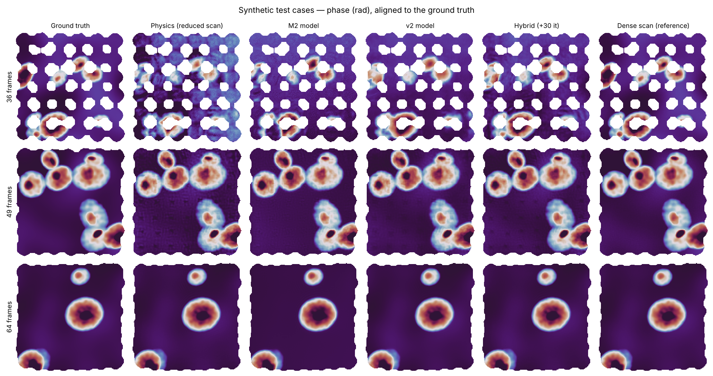
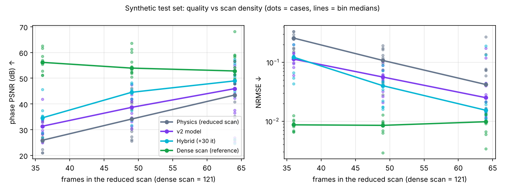
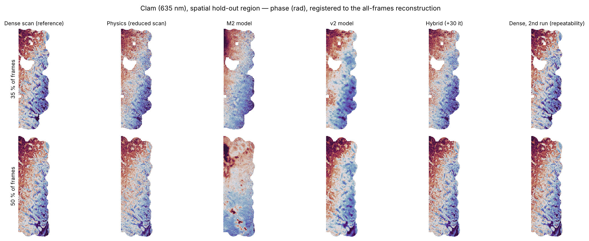
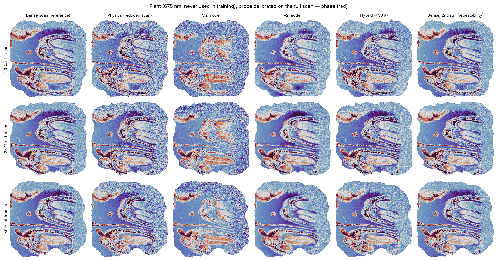

# ML pipeline — results

* [M3 — refinement model v2](#m3--refinement-model-v2-12-nov-2026) (current)
* [M2 — first baseline](#m2--first-baseline-28-oct-2026)

## M3 — refinement model v2 (12 Nov 2026)

### What changed and why
| M2 finding | M3 change |
|---|---|
| inputs unconverged (WASP, 100 it); 3× more physics beat the model in phase | inputs are **ePIE** reconstructions run to **300 it**; "physics + 300 it" is always reported as a control |
| one scan density (64 frames) | densities from frame-overlap 0.42–0.62 → **36–81 frames** (from failing to working reconstructions) |
| phase ramp not removed from inputs (the M2 report wrongly said it was) | shared `velos_recon.normalise` (ramp + median amplitude + circular-median phase, exact inverse) |
| targets in the absolute frame (network had to guess unobservable offsets) | targets moved into the **input's frame** — sub-pixel shift, ramp, complex scalar |
| Re/Im L1 only | **phase-aware loss**: L1(Re, Im) + amplitude-weighted wrapped-phase L1 + gradient L1 |
| synthetic-only model degraded real data | **stage 2**: fine-tuning with experimental clam pairs (left 65 % of the field; frame draws 2–13) |
| depth-3 U-Net (receptive field < probe) | depth-4 U-Net, 7.77 M parameters (CPU-trainable: stage 1 18 min, stage 2 13 min on 2 cores) |
| real-data numbers without registration | sub-pixel registration before every comparison (see data-review §4.2) |

### Data
* **Synthetic v2**: 240 / 25 / 30 phantoms, 256 px, 64 px probe variants, 5e3–5e4 photons/pixel (Poisson), reduced
  scans of 36–81 frames (test split: 36, 49 and 64 frames), dense reference 121 frames; ePIE (α = β = 1), 300 it
  (reduced) / 150 it (dense). Generation: 295 samples in 60 min on 2 cores.
* **Experimental — clam (635 nm, 400 frames, 128 px crop, 10 µm pixels)**: reference = ePIE 200 it on all frames;
  inputs = ePIE 200 it on 14 random subsets (35 %, 50 % and 12 random fractions 30–60 %). Training uses subsets
  2–13 and only the left 65 % of the field; **test** = subsets 0–1 (35 %, 50 %) on the right 35 % of the field.
* **Experimental — plant (675 nm, 200 frames, 5.3 µm pixels)**: never used for training. Reduced scans of 20/35/50 %
  with the probe calibrated on the full scan (`real_plant_cal`), and without calibration (`real_plant`, physics fails).
* **Repeatability**: a second all-frames reconstruction with another seed (`dense_repeat`) shows how well the
  reference itself is defined (clam: 43 dB / NRMSE 0.05; plant: 32 dB / NRMSE 0.17–0.19).

### Results
Evaluation protocol: global complex scalar, linear phase ramp and **sub-pixel translation** removed before every
metric; "prediction error" = data misfit on frames that were **not** used (synthetic: the 121 dense-scan frames;
experimental: the held-out frames) — a ground-truth-free check of whether an estimate is closer to the real object.

#### Synthetic test set (n = 30, ground truth; registered, ramp and scalar removed)

| Method | NRMSE ↓ | Phase PSNR (dB) ↑ | Phase SSIM ↑ | Amp PSNR (dB) ↑ | Amp SSIM ↑ | Data err. used ↓ | Prediction err. (unmeasured frames) ↓ |
|---|---|---|---|---|---|---|---|
| Physics, reduced scan (ePIE 300 it) | 0.128 ± 0.099 | 34.8 ± 10.3 | 0.747 | 10.6 | 0.182 | 0.0002 | 0.0135 |
| Physics + 300 further it | 0.116 ± 0.091 | 36.0 ± 10.5 | 0.772 | 11.3 | 0.197 | 0.0005 | 0.0130 |
| M2 model | 0.107 ± 0.060 | 32.6 ± 5.6 | 0.740 | 15.3 | 0.317 | 0.0041 | 0.0128 |
| v2, synthetic only (stage 1) | 0.068 ± 0.052 | 38.6 ± 8.7 | 0.887 | 18.5 | 0.446 | 0.0032 | 0.0115 |
| **v2 model (final)** | 0.068 ± 0.050 | 38.5 ± 8.6 | 0.887 | 17.8 | 0.428 | 0.0030 | 0.0115 |
| Hybrid v2 + 10 it | 0.061 ± 0.052 | 40.5 ± 8.9 | 0.901 | 17.7 | 0.322 | 0.0016 | 0.0105 |
| **Hybrid v2 + 30 it** | 0.059 ± 0.054 | 41.3 ± 9.2 | 0.907 | 18.0 | 0.321 | 0.0016 | 0.0103 |
| Hybrid v2 + 100 it | 0.058 ± 0.055 | 42.1 ± 9.4 | 0.918 | 18.1 | 0.328 | 0.0017 | 0.0101 |
| Dense scan, 121 frames (reference) | 0.009 ± 0.003 | 55.4 ± 4.9 | 0.996 | 29.4 | 0.583 | – | – |

#### By number of frames (phase PSNR dB / NRMSE)

| Method | 36 frames (n=8) | 49 frames (n=10) | 64 frames (n=12) |
|---|---|---|---|
| Physics, reduced scan (ePIE 300 it) | 25.6 / 0.246 | 34.2 / 0.107 | 41.3 / 0.066 |
| Physics + 300 further it | 26.5 / 0.227 | 35.2 / 0.098 | 43.0 / 0.057 |
| M2 model | 28.3 / 0.174 | 34.1 / 0.083 | 34.2 / 0.084 |
| v2, synthetic only (stage 1) | 31.7 / 0.119 | 38.2 / 0.056 | 43.4 / 0.044 |
| **v2 model (final)** | 31.8 / 0.118 | 38.1 / 0.057 | 43.3 / 0.045 |
| Hybrid v2 + 10 it | 33.3 / 0.108 | 41.1 / 0.044 | 44.9 / 0.043 |
| **Hybrid v2 + 30 it** | 33.6 / 0.108 | 42.0 / 0.042 | 45.9 / 0.041 |
| Hybrid v2 + 100 it | 34.0 / 0.107 | 43.0 / 0.039 | 46.6 / 0.040 |
| Dense scan, 121 frames (reference) | 56.3 / 0.009 | 55.6 / 0.008 | 54.5 / 0.010 |

#### Experimental data (reference = reconstruction from all frames; registered)

| Case | Method | NRMSE ↓ | Phase PSNR ↑ | Phase SSIM ↑ | Data err. used ↓ | Prediction err. (frames not used) ↓ |
|---|---|---|---|---|---|---|
| real_clam/sub_00 | Physics, reduced scan (ePIE 300 it) | 0.428 | 24.6 | 0.376 | 0.0292 | 0.1129 |
| real_clam/sub_00 | M2 model | 0.475 | 23.4 | 0.238 | 0.0684 | 0.1143 |
| real_clam/sub_00 | v2, synthetic only (stage 1) | 0.425 | 24.7 | 0.309 | 0.0591 | 0.0980 |
| real_clam/sub_00 | **v2 model (final)** | 0.344 | 26.5 | 0.445 | 0.0426 | 0.0843 |
| real_clam/sub_00 | Hybrid v2 + 10 it | 0.369 | 26.0 | 0.433 | 0.0318 | 0.0915 |
| real_clam/sub_00 | **Hybrid v2 + 30 it** | 0.389 | 25.5 | 0.421 | 0.0307 | 0.0981 |
| real_clam/sub_00 | Hybrid v2 + 100 it | 0.408 | 25.0 | 0.412 | 0.0339 | 0.1064 |
| real_clam/sub_00 | All frames, 2nd run (repeatability) | 0.052 | 43.3 | 0.992 | 0.0227 | 0.0220 |
| real_clam/sub_01 | Physics, reduced scan (ePIE 300 it) | 0.304 | 27.1 | 0.602 | 0.0252 | 0.0634 |
| real_clam/sub_01 | M2 model | 0.484 | 22.4 | 0.240 | 0.0782 | 0.0939 |
| real_clam/sub_01 | v2, synthetic only (stage 1) | 0.476 | 21.9 | 0.223 | 0.0770 | 0.0867 |
| real_clam/sub_01 | **v2 model (final)** | 0.257 | 28.4 | 0.626 | 0.0379 | 0.0527 |
| real_clam/sub_01 | Hybrid v2 + 10 it | 0.236 | 29.4 | 0.724 | 0.0262 | 0.0530 |
| real_clam/sub_01 | **Hybrid v2 + 30 it** | 0.213 | 30.4 | 0.804 | 0.0316 | 0.0535 |
| real_clam/sub_01 | Hybrid v2 + 100 it | 0.202 | 30.4 | 0.829 | 0.0434 | 0.0586 |
| real_clam/sub_01 | All frames, 2nd run (repeatability) | 0.055 | 42.7 | 0.991 | 0.0212 | 0.0232 |
| real_plant_cal/sub_00 | Physics, reduced scan (ePIE 300 it) | 0.453 | 25.0 | 0.587 | 0.0215 | 0.0841 |
| real_plant_cal/sub_00 | M2 model | 0.510 | 24.6 | 0.430 | 0.0447 | 0.0996 |
| real_plant_cal/sub_00 | v2, synthetic only (stage 1) | 0.510 | 23.3 | 0.409 | 0.0556 | 0.0981 |
| real_plant_cal/sub_00 | **v2 model (final)** | 0.421 | 26.5 | 0.623 | 0.0319 | 0.0643 |
| real_plant_cal/sub_00 | Hybrid v2 + 10 it | 0.421 | 26.3 | 0.626 | 0.0260 | 0.0679 |
| real_plant_cal/sub_00 | **Hybrid v2 + 30 it** | 0.423 | 26.0 | 0.621 | 0.0262 | 0.0729 |
| real_plant_cal/sub_00 | Hybrid v2 + 100 it | 0.424 | 25.4 | 0.608 | 0.0310 | 0.0813 |
| real_plant_cal/sub_00 | All frames, 2nd run (repeatability) | 0.188 | 31.6 | 0.848 | 0.0401 | 0.0421 |
| real_plant_cal/sub_01 | Physics, reduced scan (ePIE 300 it) | 0.407 | 27.3 | 0.666 | 0.0336 | 0.0670 |
| real_plant_cal/sub_01 | M2 model | 0.512 | 25.3 | 0.440 | 0.0583 | 0.0834 |
| real_plant_cal/sub_01 | v2, synthetic only (stage 1) | 0.484 | 24.0 | 0.449 | 0.0684 | 0.0847 |
| real_plant_cal/sub_01 | **v2 model (final)** | 0.388 | 28.1 | 0.681 | 0.0432 | 0.0583 |
| real_plant_cal/sub_01 | Hybrid v2 + 10 it | 0.383 | 28.6 | 0.718 | 0.0368 | 0.0604 |
| real_plant_cal/sub_01 | **Hybrid v2 + 30 it** | 0.380 | 28.3 | 0.688 | 0.0392 | 0.0646 |
| real_plant_cal/sub_01 | Hybrid v2 + 100 it | 0.366 | 28.1 | 0.722 | 0.0522 | 0.0762 |
| real_plant_cal/sub_01 | All frames, 2nd run (repeatability) | 0.191 | 31.8 | 0.847 | 0.0442 | 0.0404 |
| real_plant_cal/sub_02 | Physics, reduced scan (ePIE 300 it) | 0.360 | 27.5 | 0.692 | 0.0370 | 0.0743 |
| real_plant_cal/sub_02 | M2 model | 0.473 | 25.8 | 0.519 | 0.0565 | 0.0906 |
| real_plant_cal/sub_02 | v2, synthetic only (stage 1) | 0.444 | 24.0 | 0.482 | 0.0661 | 0.0901 |
| real_plant_cal/sub_02 | **v2 model (final)** | 0.364 | 27.8 | 0.672 | 0.0427 | 0.0644 |
| real_plant_cal/sub_02 | Hybrid v2 + 10 it | 0.355 | 28.4 | 0.714 | 0.0388 | 0.0660 |
| real_plant_cal/sub_02 | **Hybrid v2 + 30 it** | 0.348 | 28.3 | 0.714 | 0.0433 | 0.0700 |
| real_plant_cal/sub_02 | Hybrid v2 + 100 it | 0.335 | 27.9 | 0.665 | 0.0670 | 0.0886 |
| real_plant_cal/sub_02 | All frames, 2nd run (repeatability) | 0.174 | 32.2 | 0.871 | 0.0415 | 0.0419 |
| real_plant/sub_01 | Physics, reduced scan (ePIE 300 it) | 0.543 | 22.1 | 0.194 | 0.0633 | 0.1535 |
| real_plant/sub_01 | M2 model | 0.585 | 22.3 | 0.159 | 0.0767 | 0.1531 |
| real_plant/sub_01 | v2, synthetic only (stage 1) | 0.582 | 21.9 | 0.204 | 0.0800 | 0.1381 |
| real_plant/sub_01 | **v2 model (final)** | 0.492 | 23.4 | 0.262 | 0.0874 | 0.1110 |
| real_plant/sub_01 | Hybrid v2 + 10 it | 0.500 | 23.1 | 0.254 | 0.0723 | 0.1213 |
| real_plant/sub_01 | **Hybrid v2 + 30 it** | 0.508 | 22.7 | 0.250 | 0.0749 | 0.1330 |
| real_plant/sub_01 | Hybrid v2 + 100 it | 0.513 | 22.4 | 0.231 | 0.0916 | 0.1513 |
| real_plant/sub_02 | Physics, reduced scan (ePIE 300 it) | 0.479 | 23.0 | 0.274 | 0.0669 | 0.1481 |
| real_plant/sub_02 | M2 model | 0.502 | 23.1 | 0.248 | 0.0845 | 0.1592 |
| real_plant/sub_02 | v2, synthetic only (stage 1) | 0.487 | 23.2 | 0.298 | 0.0779 | 0.1425 |
| real_plant/sub_02 | **v2 model (final)** | 0.459 | 23.6 | 0.284 | 0.0838 | 0.1240 |
| real_plant/sub_02 | Hybrid v2 + 10 it | 0.453 | 23.5 | 0.319 | 0.0728 | 0.1292 |
| real_plant/sub_02 | **Hybrid v2 + 30 it** | 0.455 | 23.3 | 0.312 | 0.0784 | 0.1364 |
| real_plant/sub_02 | Hybrid v2 + 100 it | 0.453 | 23.2 | 0.313 | 0.1015 | 0.1516 |

### Interpretation (including what did not work)
1. **Synthetic, ground truth**: the v2 model improves the converged reduced-scan reconstruction by **+3.7 dB phase
   PSNR** (34.8 → 38.5 dB; NRMSE 0.128 → 0.068; phase SSIM 0.75 → 0.89) — more than 300 extra physics iterations
   (+1.2 dB). **Hybrid** (+30 physics it) reaches **+6.5 dB** (41.3 dB, NRMSE 0.059) and lowers the prediction error on
   the unmeasured frames by 24 %. Gains are largest where physics struggles (36 frames: +6.2 dB model, +8.0 dB hybrid;
   49 frames: +3.9 / +7.8 dB); on 64-frame scans +2.0 / +4.6 dB. The M2 model is worse than physics on this test set
   (32.6 dB; −7 dB on 64-frame scans) — it was trained on WASP inputs without ramp removal.
2. **A large gap to the dense scan remains** (55.4 dB, NRMSE 0.009). The model reduces the cost of measuring fewer
   frames; it does not replace the measurements.
3. **Experimental, clam hold-out** (region and frame draws never seen in training): v2 improves the agreement with the
   all-frames reconstruction (+1.9 dB at 35 % of the frames, +1.3 dB at 50 %; NRMSE −20 % / −15 %) and predicts the
   frames that were not measured **25 % / 17 % better**. Hybrid (+30 it) at 50 %: +3.3 dB, NRMSE 0.304 → 0.213.
4. **Experimental, unseen specimen (plant, probe calibrated)**: +1.5 / +0.8 / +0.3 dB at 20 / 35 / 50 % of the frames;
   prediction error −24 / −13 / −13 %. The reference itself repeats only to ~32 dB here, so the PSNR differences are
   within its uncertainty; the prediction error (no reference needed) consistently favours v2.
5. **Fine-tuning on experimental data was essential**: on the five experimental test cases (clam, calibrated plant) the
   synthetic-only v2 and the M2 model are worse than physics in 9 of 10 comparisons (by 0.4–5.2 dB phase PSNR; the
   exception is the synthetic-only model at 35 % clam, +0.1 dB). Biological samples will need the same step (M4).
6. **Hybrid on experimental data: short is better.** Beyond ~10 physics iterations the error on the unmeasured frames
   rises again (clam 35 %: 0.084 → 0.092 → 0.098 → 0.106 for 0 → 10 → 30 → 100 it) while the measured frames are
   fitted ever better — the polish over-fits the sparse measurements. Recommended `hybrid_iters`: 10 for experimental
   data (in the model card).
7. **Physics failures are not repaired.** Without probe calibration the reduced plant scans fail; v2 lowers the
   prediction error (0.154 → 0.111) but the result stays far below the calibrated physics (23 vs 27 dB). The
   platform therefore supports probe calibration (`probe_from_job`).
8. **Visible behaviour**: v2 removes noise and grid artefacts but also smooths fine texture and can add slow phase
   deviations near the field edge (plant figure in the M3 report); the hybrid step restores fine texture.

### Package
`velos-refine-v2` 2.0.0: `model.onnx` + `model.ts` + `model_card.json`; export verified against PyTorch (max |Δ|
1.8e-5 ONNX, 0 TorchScript); ONNX Runtime ≈ 130 ms per 256-px tile on 2 CPU cores. Reproduce everything with
`ml/scripts/m3_pipeline.sh`.

## M2 — first baseline (28 Oct 2026)

### Setup
* **Task**: sparse-scan refinement. Input = Client's physics engine (`wasp`, probe_lr 0.1, 100 it) on a sparse scan
  (64 frames, frame-overlap 0.60 ≈ 33 % true aperture overlap); target = ground-truth complex object.
  Dense reference = same engine on 121 frames (frame-overlap 0.70), 120 it.
* **Data**: 200 / 25 / 30 synthetic cell phantoms (phase 0.6–3 rad, nuclei, weak absorption, texture; probe
  variants; photons 5e3–5e4 per frame, Poisson). Generated with the Client's forward model (`core.simulate`).
* **Model**: residual U-Net, 3 → 2 channels (Re, Im, mask → Re, Im), base 32, depth 3, 1.93 M parameters.
* **Training**: AdamW 1e-3 + OneCycle, masked L1, 128 px random crops with flips/rotations, batch 8, 30 epochs,
  seed 0, CPU (2 cores, ≈ 20 min). Best val loss 0.0370 (epoch 29).
* **Metrics**: inside the region illuminated by both scans, after removing the global complex scalar and the
  linear phase ramp (both unobservable in ptychography). n = 30 test phantoms, mean ± std.

### Results (test split)

| Method | NRMSE ↓ | PSNR amp (dB) ↑ | SSIM amp ↑ | PSNR phase (dB) ↑ | SSIM phase ↑ | MAE phase (rad) ↓ |
|---|---|---|---|---|---|---|
| Physics baseline (sparse, 100 it) | 0.120 ± 0.072 | 8.2 ± 4.9 | 0.140 ± 0.072 | 32.7 ± 7.0 | 0.765 ± 0.162 | 0.060 ± 0.043 |
| Physics baseline (sparse, 300 it) — control | 0.090 ± 0.062 | 10.5 ± 5.9 | 0.213 ± 0.110 | 36.9 ± 8.7 | 0.885 ± 0.113 | 0.036 ± 0.029 |
| Physics (sparse, 100 it) + ML | 0.095 ± 0.055 | **14.6 ± 5.2** | **0.504 ± 0.113** | 33.9 ± 6.7 | 0.784 ± 0.123 | 0.050 ± 0.029 |
| Physics (sparse, 300 it) + ML | **0.083 ± 0.047** | **15.7 ± 5.2** | **0.560 ± 0.120** | 35.1 ± 6.6 | 0.796 ± 0.123 | 0.045 ± 0.025 |
| Physics reference (dense, 121 frames) | 0.014 ± 0.007 | 26.7 ± 5.2 | 0.781 ± 0.068 | 51.2 ± 5.5 | 0.976 ± 0.026 | 0.008 ± 0.004 |

### Interpretation (what the numbers say, including the unsuccessful parts)
1. The model **does** improve on its input: NRMSE 0.120 → 0.095, amplitude PSNR +6.4 dB, amplitude SSIM 0.14 → 0.50.
   Visually it removes the grid-pathology ringing and coverage-related amplitude blow-ups of sparse scans.
2. Phase gains are small (+1.2 dB PSNR, SSIM 0.765 → 0.784). **Running the physics engine 3× longer gives better
   phase than the ML refinement** (36.9 dB / 0.885). The first model therefore mainly corrects amplitude; it is not yet a
   substitute for iterations in phase. Applying the model after the longer run gives the best sparse result overall
   (NRMSE 0.083) but still below the physics phase control.
3. A large gap to the dense reference remains (NRMSE 0.014); 47 % fewer frames is not recovered by this baseline.
4. **Real data (negative result)**: applied to the clam reconstruction from 50 % of frames, the synthetic-trained model
   smooths away genuine tissue texture and distorts phase — metrics against the 400-frame reference get worse
   (NRMSE 0.35 → 0.49). The model must not be used on experimental data until it is trained/validated on it.

> **Corrections made in M3.** (1) The M2 report said the model inputs had the linear phase ramp removed; in the
> M2 code only the median amplitude/phase were normalised (the ramp was removed for metrics only). M3 moved
> normalisation into `velos_recon.normalise` with ramp removal. (2) The M2 real-data numbers (NRMSE 0.35 → 0.49)
> were computed without sub-pixel registration; M3 found 0.1–0.9 px offsets between reconstructions and now
> registers before comparing. The M2 conclusion (do not use that model on real data) is unchanged.

### Planned for M3 (→ done, see above)
* Train on converged physics inputs (≥ 300 it) and on a wider overlap range so the model learns beyond what more
  iterations give; add a phase-gradient / physics-consistency loss term; larger model and dataset on the GPU worker.
* Build an experimental training set from the Client's real datasets (dense scan reconstructions as targets, sub-sampled
  scans as inputs) to remove the domain shift observed above.
* Package the selected checkpoint (TorchScript export already available: `evidence/ml/baseline_unet.torchscript.pt`,
  bit-identical to the eager model) and wire `refine_ml=true` jobs through the worker on the staging stack.
